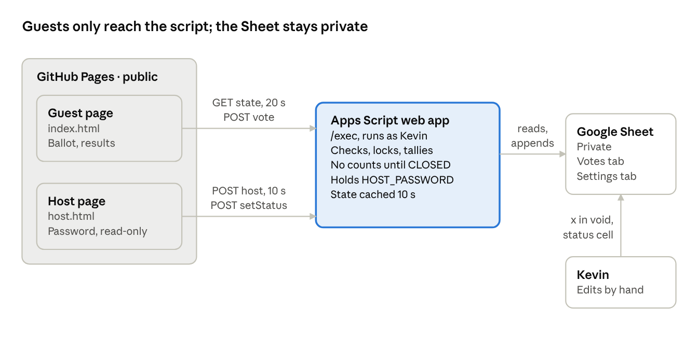
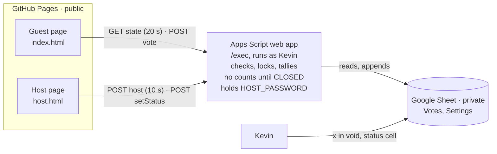

# Discount Halloween Ballot — Implementation Plan

Nov 4, 2026 · Kevin

## Overview

Build a phone-first costume ballot for a 30-guest "Discount Halloween" party: two static pages on GitHub Pages, backed by one Google Apps Script web app writing to a private Google Sheet. No accounts, no photos, no framework, no build step.

How the night works: each guest's costume is photographed on a Polaroid, given a number (1–30), and pinned to a board. Guests open the ballot, type their name, and enter one Polaroid number for each of four categories. The host watches live tallies on a password-protected screen and closes voting, which shows "Voting is closed. Stay tuned for the winners!" on every guest's phone, under their receipt if they voted. The host then announces the winners from the host page.

**Goals**

- Voting takes under 30 seconds on any phone, with no sign-in.
- Results stay hidden from guests, even after voting closes. Only the host page shows them.
- One ballot per phone, enforced as well as a browser allows, with likely duplicates flagged for the host.
- The Google Sheet is the back office: the host fixes anything by editing it.

**Decisions already made**

- Categories, in this order: Best, Favorite, Most discount, Runner up.
- The same number may be entered in more than one category.
- A ballot is final once cast. There is no edit or change-vote flow.
- Voting for your own Polaroid is on the honor system.
- The host screen is read-only except for opening and closing voting. Voiding a ballot happens in the Sheet (an `x` in the `void` column), not in the app.

**Non-goals:** accounts or logins for guests, photo upload, editing votes in the app, multiple events, and analytics.

## Architecture

Two public static pages talk to one Apps Script web app, and only the script can read the private Sheet. That boundary is what keeps results secret and the password out of page code.





The pages hold no secrets and no counts. Every check (status, picks, duplicate device, password) runs in the script, which runs as Kevin. Kevin can still fix anything directly in the Sheet.

## Data model

One Google Sheet with two tabs, plus one secret in Script Properties. A `setup()` function in the script creates both tabs and their headers, so the host never builds them by hand.

**`Votes` tab:** one row per ballot, header in row 1, appended in order.

| Column | Example | Notes |
| --- | --- | --- |
| `ballot_id` | `b_7f3c…` | Server-generated `Utilities.getUuid()` |
| `submitted_at` | `2026-10-31T21:41:07-04:00` | Server time, ISO 8601 |
| `name` | `Dana` | Trimmed, 1–40 characters. Prefixed with `'` if it starts with `= + - @`, so Sheets never runs it as a formula |
| `best` | `12` | Integer 1–`board_size` |
| `favorite` | `7` | Same |
| `most_discount` | `21` | Same |
| `runner_up` | `3` | Same |
| `device_id` | `5b0e…` | Random UUID kept in the guest's browser |
| `fingerprint` | `a91c04d2e8b37f10` | 16-hex hash of browser traits; used only for flagging |
| `user_agent` | `Mozilla/5.0 (iPhone…` | Sent by the page, since Apps Script can't read request headers |
| `void` | blank or `x` | Host types `x` to exclude the ballot. Any non-blank value counts as void |

**`Settings` tab:** key in column A, value in column B.

| Key | Default | Values |
| --- | --- | --- |
| `status` | `SOON` | `SOON` (ballot not open yet), `OPEN`, `CLOSED` |
| `board_size` | `30` | Highest Polaroid number on the board |

The host can change either cell by hand. The app reads them on every request, with at most a 10-second cache.

**Script Properties:** `HOST_PASSWORD`, set in the Apps Script editor under Project Settings. It never appears in the repo or in page code.

The Sheet stays private: never "Publish to web" and never share it by link. The script runs as the owner, so it is the only reader guests reach.

## API contract

One web app URL (`…/exec`) serves everything. Every response is JSON via `ContentService.createTextOutput(JSON.stringify(x)).setMimeType(ContentService.MimeType.JSON)`, and always carries `ok`. Errors return `{ "ok": false, "error": "<code>", "message": "<human text>" }` with HTTP 200, because Apps Script can't set status codes.

**Transport rules (these prevent browser blocks):**

- Reads use `GET …/exec?action=state`.
- Writes use `POST …/exec` with the JSON as the raw body and no custom headers. Call `fetch(url, { method: 'POST', body: JSON.stringify(payload) })`, which sends `text/plain` and avoids a CORS preflight that Apps Script can't answer. The script reads `JSON.parse(e.postData.contents)`.
- Never set `Content-Type: application/json`.
- Fetch follows Apps Script's 302 redirect to `script.googleusercontent.com` on its own. Don't set `redirect: 'manual'`.

**`GET ?action=state`** (guest page; public)

```json
{ "ok": true, "status": "OPEN", "boardSize": 30 }
```

The response is the same in every status. It must never contain counts or results of any kind, not even `ballotCount`, even once voting is `CLOSED`: the winners are announced at the party, and anyone can read this response in their browser.

A phone that has voted adds `&ref=<ballotId>` (or `&ref=<deviceId>` if it was told `already_voted` and has no ballot ID). If that ballot was unlocked, the response gains `"unlocked": true`, and the rest is unchanged. A phone that hasn't voted sends no `ref`, so its response is exactly the public state and costs no read of the votes. The list of unlocked ballots is cached for 10 s and comes from the `void` column. A receipt asks by ballot ID so that a new ballot can never match an old entry, even in a cached list. A device is only listed while it has no other ballot on file.

**`POST { action: "vote" }`** (guest page; public)

```json
{ "action": "vote", "name": "Dana",
  "picks": { "best": 12, "favorite": 7, "most_discount": 21, "runner_up": 3 },
  "deviceId": "5b0e9c1a-…", "fingerprint": "a91c04d2e8b37f10", "userAgent": "Mozilla/5.0 …" }
```

It returns `{ "ok": true, "ballotId": "b_7f3c…", "submittedAt": "…" }`. The server checks, in this order, while holding `LockService.getScriptLock()`, trying for it with `tryLock(1000)` for up to 75 s. In live testing with 30 simultaneous votes, `waitLock(10000)` rejected 23, and `waitLock(90000)` left the lock free for a minute and rejected 2:

1. `status` is `OPEN`. Otherwise return `not_open` (`SOON`) or `closed` (`CLOSED`).
2. `deviceId` is a UUID and `fingerprint` is 1–64 hex characters. Otherwise return `bad_request`.
3. `name`, trimmed, is 1–40 characters with control characters removed. Otherwise return `invalid_name`.
4. Each of the four picks is an integer from 1 to `board_size`. Otherwise return `invalid_pick` with `"field": "<key>"` for the first bad one.
5. No existing row has this `device_id`, void or not, unless that row is unlocked. Otherwise return `already_voted`.
6. Append the row with `appendRow`, then release the lock.

**`POST { action: "host", password }`** (host page)

This is a read-only dashboard snapshot. `tallies` lists every number that got a vote, sorted by votes descending and then by number ascending. `ballots` is newest first. Void ballots are listed but excluded from `ballotCount` and `tallies`.

```json
{ "ok": true, "status": "OPEN", "boardSize": 30, "ballotCount": 27, "voidCount": 1,
  "tallies": { "best": [{ "number": 12, "votes": 11 }, { "number": 4, "votes": 7 }], "favorite": […], "most_discount": […], "runner_up": […] },
  "flagGroups": [["b_3…", "b_5…"]],
  "ballots": [{ "ballotId": "b_5…", "submittedAt": "…", "name": "Dana",
                "picks": { "best": 12, "favorite": 7, "most_discount": 21, "runner_up": 3 },
                "void": false, "unlocked": false, "flagGroup": 0 }],
  "serverTime": "…" }
```

`flagGroups` are sets of two or more non-void ballots that share a `fingerprint`. `flagGroup` on a ballot is its index in that list, or `null`.

**`POST { action: "setStatus", password, status }`** (host page)

This writes `SOON`, `OPEN` or `CLOSED` to `Settings!B` and clears the state cache. It returns `{ "ok": true, "status": "CLOSED" }`.

**`POST { action: "unlock", password, ballotId }`** (host page)

This writes `unlocked` to that ballot's `void` cell and clears the cached list of unlocked ballots. The ballot stops counting right away, and its phone can vote again, because `already_voted` ignores unlocked rows. The old row stays in the Sheet for the record. It returns `{ "ok": true, "ballotId": "b_…" }`, `bad_request` if there's no such ballot, or `closed` if voting is closed, so a stray tap can't change the count the host is about to announce. It takes no lock: it changes one existing cell, and the host shouldn't queue behind a burst of votes.

The status and this are the only writes the host page can make. An `x` (or anything else) in the `void` cell is still a plain void, and that phone stays locked.

**Password handling:** compare against `HOST_PASSWORD`. A wrong password returns `bad_password`. Count failures in `CacheService` and return `too_many_attempts` after 10 failures within 10 minutes.

**Error codes:** `not_open`, `closed`, `bad_request`, `invalid_name`, `invalid_pick`, `already_voted`, `bad_password`, `too_many_attempts`, `server_error` (any thrown exception, logged with `console.error`).

## Guest page (`index.html`)

One page that picks its screen from two inputs: the server `status` and whether this browser has already voted (`localStorage`). There is no routing. One `render()` swaps the visible `<section>` with `el.hidden`.

| Screen | Shows when | What it does |
| --- | --- | --- |
| Loading | First `state` fetch in flight | Logo plus "Opening the store…" |
| Soon | `status` is `SOON` | "Voting opens soon." Polls every 20 s |
| Ballot | `OPEN` and no saved ballot | Name plus four number stickers plus Cast ballot |
| Voted | `OPEN` or `CLOSED`, and a saved ballot exists | Receipt of their picks. Polls every 20 s. Once `CLOSED`, "Voting is closed. Stay tuned for the winners!" appears below the receipt, centered, in place of the line under "Voted." |
| Closed | `CLOSED` and no saved ballot | The logo and "Voting is closed. Stay tuned for the winners!", centered. No results. Polls every 20 s so it comes back if the host reopens voting |
| Can't connect | `state` fetch fails twice | "Can't reach the ballot box. Check your signal." plus a Try again button |

**Ballot form**

- Name: `<input autocomplete="name" maxlength="40">`, required.
- Four number fields, in category order, each `<input type="text" inputmode="numeric" pattern="[0-9]*" maxlength="2">` with a visible `<label>`. Strip non-digits on input.
- Validate live against `boardSize` from `state`. A number out of range shows "No #47 on the board" under that category and keeps the sticker dashed.
- Cast ballot stays disabled until the name and all four numbers are valid. On tap it disables and reads "Casting…".
- Enter in the last field submits. Moving between fields needs no extra handling: the numeric keypad's Next and Tab are enough.

**Submit outcomes**

- `ok`: save `{ ballotId, name, picks, submittedAt }` to `localStorage['dh.ballot']` and show Voted.
- `already_voted`: save `{ alreadyVoted: true }` and show Voted with "This phone already voted." in place of the receipt lines.
- `invalid_pick` or `invalid_name`: show the inline error on that field and re-enable the button.
- `closed` or `not_open`: re-fetch `state` and render.
- Network failure: keep the form filled, show "Didn't go through. Try again." and re-enable the button. Retrying is safe because a second success is impossible (the device ID is already stored).

**Polling:** fetch `state` every 20 s while the tab is visible. Fetch once on `visibilitychange` back to visible. Add 0–3 s of random jitter so 30 phones don't hit the script in step.

**Unlocked:** when `state` answers `"unlocked": true`, delete `dh.ballot` and go back to the Ballot form, filled in with the name and picks from the old receipt, under the line "The host reopened your ballot. Cast it again." The device ID stays. A phone told `already_voted` has no picks saved, so its form is empty.

**Storage keys:** `dh.deviceId` (UUID, created on first load), `dh.ballot` (JSON). Wrap every read and write in `try/catch`. If storage is blocked, voting still works, but the one-per-phone check then rests on the server's device ID and fingerprint alone.

## Host page (`host.html`)

This is a separate URL that isn't linked from the guest page. It has two screens: Login and Dashboard. It changes the voting status and unlocks ballots. Everything else is fixed in the Sheet.

**Login**

- One `<input type="password" autocomplete="current-password">` plus an Unlock button, inside a real `<form>` (`preventDefault` on submit).
- Submit calls `host`. On `ok`, keep the password in `sessionStorage['dh.hostPass']` (gone when the tab closes) and show Dashboard. On `bad_password`, show "Wrong password. Try again." On `too_many_attempts`, show "Too many tries. Wait 10 minutes."
- On load, if `dh.hostPass` exists, try it silently and skip Login when it works.

**Dashboard**, top to bottom:

1. Header: "Host" plus a status pill (`Voting soon`, `Voting open` with an orange dot, `Closed`).
2. Stats row with three numbers: Ballots (`ballotCount`), On the board (`boardSize`), Flagged (ballots in any flag group; yellow when above 0).
3. Status control: three buttons, **Soon**, **Open** and **Closed**, with the current one filled orange. Any change takes two taps. The first turns that button yellow and changes it to "Tap again", with a Cancel link. It reverts after 5 s, and tapping the current status backs out too. A helper line says what guests see now, or what the second tap will do, such as "Closing ends voting on every guest's phone."
4. Live results: "Only you see this". For each category, show the top 3 numbers as horizontal bars, with bar length equal to votes divided by `ballotCount`. Every number tied for first gets the orange bar and bright text. The rest are muted.
5. "Same phone?": each flag group as a block of rows (name, time, picks as `12 · 7 · 21 · 3`). Under it: "These ballots look like they came from one phone. To toss one, type x in its Void cell in the Sheet." Add an "Open the Sheet" link if `SHEET_URL` is set in config.
6. Ballots: newest first, all of them. Void ballots are struck through with a "Void" tag, or "Unlocked" if they were unlocked. Flagged ones carry a yellow "Flag" tag. A column hint reads `Best · Fav · Disc · Runner`. Each ballot has an **Unlock** button, with the same two taps as the status control, until it's unlocked. While `CLOSED` there are no Unlock buttons. Helper line: "Unlock tosses a ballot and lets that phone vote again."
7. Footer: "Updated 9:41:05 PM" from `serverTime`.

**Polling:** call `host` every 10 s while the tab is visible, and right after any `setStatus` or `unlock`. On `bad_password` during polling (the password was changed), drop `dh.hostPass` and return to Login.

**Changes from the mockup:** the per-ballot Toss button is dropped, and voiding lives in the Sheet. The single status button becomes the three-way control, and each ballot gets an Unlock button.

## Design spec

Match the mockups in `docs/mockups/` (one `.dc.html` file per screen; the original canvas is at https://claude.ai/artifact/9wCzkeWExbzMNeuhwjdUfM): a dark, cheap-costume-store look, extremely pared down. In each mockup file, the markup and inline styles are the reference; ignore the `support.js` line and the `<script type="text/x-dc">` block, which belong to the design tool. It uses one deliberate dark theme with no light mode. Lay it out mobile-first for 390 px, in a single column capped at `max-width: 440px` and centred on larger screens, with 20 px side padding.

**Tokens** (`assets/app.css`, on `:root`, plus `color-scheme: dark`):

| Token | Value | Use |
| --- | --- | --- |
| `--bg` | `#121010` | Page background |
| `--ink` | `#f3efe8` | Primary text |
| `--dim` | `#9a918a` | Secondary text, labels |
| `--placeholder` | `#7a716b` | Input placeholders |
| `--line` | `#2c2725` | Row rules |
| `--line-strong` | `#3a3431` | Input underlines, ghost buttons |
| `--bar-muted` | `#6b625d` | Non-leading result bars, empty sticker ring |
| `--paper` | `#f7f4ee` | Receipt |
| `--paper-ink` | `#141212` | Text on paper, orange and yellow |
| `--paper-dim` | `#4a4441` | Secondary text on paper |
| `--orange` | `#ff6a13` | Primary buttons, bands, leading bars |
| `--sticker` | `#ffd60a` | Filled number stickers, logo letters, flags, errors |

**Type:** load from Google Fonts with `display=swap`.

- Display: Anton 400 (fallback `Impact, 'Arial Narrow', sans-serif`), always uppercase.
- Body: Archivo 400/600 at 16 px.
- Labels: IBM Plex Mono 500/600, 11–12 px, uppercase, `letter-spacing: 0.08em`.
- Use `font-variant-numeric: tabular-nums` on every count.

**Components**

- **Logo** (Ballot, Soon and Loading screens): `assets/logo.svg`, all outlines, so it needs no web font. "Discount" and "Halloween" are stacked into one shape: bouncing Spicy Rice letters in `--sticker`, with a dark outline, a thin `--orange` outer outline and four-point sparkles above and below. An orange "70% off" sticker in Anton sits over the bottom-right corner. It fills the column width. This replaces the price tag in the mockups. Other screens use a mono eyebrow "Discount Halloween" instead.
- **Number sticker:** a 70 px circle rotated −7°. Empty, it has a 2 px dashed `--bar-muted` ring and an en-dash placeholder. Valid, it's solid `--sticker` with `--paper-ink` digits. Invalid, the dashed ring turns `--sticker` and the error line shows. The input sits inside the circle in Anton at 32 px.
- **Primary button:** a 56 px tall `--orange` block with Anton 22 px uppercase in `--paper-ink`. Disabled is 35% opacity.
- **Receipt** (Voted): a `--paper` slip 300 px wide, rotated −1.2°, set in mono 13 px with dashed dividers and a sawtooth bottom edge. Lines: Customer, the four picks, Items 4, Total $0.00, "No refunds. No exchanges. One ballot per phone."
- Focus ring: a 2 px `--sticker` outline at 3 px offset. Touch targets are at least 44 px. Respect `prefers-reduced-motion` (drop the hover lift).

**Copy** (keep it short and dry):

| Where | Text |
| --- | --- |
| Ballot eyebrow | Costume contest · Voting open, centered |
| Soon eyebrow | Costume contest, centered |
| Ballot label above the picks | Vote for one costume per category, in the same style as "Your name", with extra space above it |
| Receipt subtitle | Costume contest · Receipt |
| Ballot footer | One ballot per phone. No refunds. |
| Soon | Voting opens soon. |
| Voted | Voted. / Stay tuned for the winners! |
| Closed, and below the receipt once closed | Voting is closed. / Stay tuned for the winners! |
| Host login | Staff only. / Employees must wash hands |

## One vote per phone

There are three layers. Only the device ID blocks a vote. The fingerprint only flags, because a browser can't reliably identify a phone: identical iPhone models look the same to Safari, and a hard block would lock out honest guests.

| Layer | Where | Stops | Gets past it |
| --- | --- | --- | --- |
| Saved ballot | `localStorage['dh.ballot']` | Re-opening the page shows the receipt, not the form | Clearing site data, incognito, another browser |
| Device ID | `localStorage['dh.deviceId']`, checked by the server | A second POST from the same browser, even a scripted one | Same as above |
| Fingerprint | Sent with the vote and grouped on the host page | Nothing. It only **flags** likely repeats for the host | A different phone |

**Fingerprint recipe** (`assets/fingerprint.js`): join these values with `|`, SHA-256 them with `crypto.subtle.digest`, and keep the first 16 hex characters. Each value is wrapped in `try/catch` and falls back to an empty string.

- `screen.width`, `screen.height`, `screen.colorDepth`, `devicePixelRatio`
- `Intl.DateTimeFormat().resolvedOptions().timeZone`, `navigator.languages.join(',')`
- `navigator.hardwareConcurrency`, `navigator.deviceMemory`, `navigator.maxTouchPoints`, `navigator.platform`
- WebGL `UNMASKED_VENDOR_WEBGL` and `UNMASKED_RENDERER_WEBGL` (via `WEBGL_debug_renderer_info`)
- A canvas hash: draw fixed text ("Discount Halloween 70% off") in two fonts plus an arc into a 200×50 canvas, then hash `toDataURL()`

These mostly survive incognito and a second browser on the same phone. Some won't, and that's fine. What it needs to do is surface the obvious case: one phone, two names, the same picks a minute apart.

No third-party fingerprinting library and no IP logging. Everyone shares the party Wi-Fi, so an IP would flag the whole room.

## Repo layout and code structure

This is vanilla HTML, CSS and ES modules served as-is by GitHub Pages: no bundler, no framework, no npm runtime dependencies. Node is used only for local tests.

```
discount-halloween/
├─ CLAUDE.md               pointer to this plan
├─ index.html              guest page (all guest screens as <section hidden>)
├─ host.html               host page (login + dashboard)
├─ assets/
│  ├─ app.css              tokens + components, shared by both pages
│  ├─ config.js            export const API_URL, SHEET_URL, POLL_GUEST_MS, POLL_HOST_MS
│  ├─ api.js               getState(), vote(), host(), setStatus(); swaps to mock when ?mock=1
│  ├─ mock-api.js          fake of the whole contract, same responses and errors
│  ├─ fingerprint.js       export async function fingerprint()
│  ├─ guest.js             guest state machine + render
│  └─ host.js              host login, dashboard render, polling
├─ apps-script/
│  ├─ Code.gs              the whole backend (pasted into the Sheet's Apps Script project)
│  └─ appsscript.json      manifest: timeZone America/New_York, webapp access ANYONE_ANONYMOUS, executeAs USER_DEPLOYING
├─ docs/
│  ├─ PLAN.md              this plan
│  ├─ architecture.png
│  └─ mockups/             one .dc.html per screen
├─ tests/
│  ├─ logic.test.mjs       node --test: loads Code.gs in a vm and tests the pure functions
│  └─ smoke.spec.mjs       Playwright against ?mock=1 (optional)
└─ README.md               setup + deploy steps from this plan
```

**`Code.gs` structure.** Keep the Google API calls in thin wrappers and everything else pure, so the logic can be tested in Node.

- Entry points: `doGet(e)` routes `action=state`. `doPost(e)` parses the body and routes `vote`, `host`, `setStatus` and `unlock`. Both catch everything and return `server_error`.
- Sheet wrappers: `readSettings_()`, `writeStatus_(s)`, `readVotes_()` (one `getDataRange().getValues()` call), `appendVote_(row)`, `writeUnlocked_(ballotId)`.
- Pure functions:
    - `validateBallot(body, boardSize)` returns `{ ok, error, field, clean }`.
    - `sanitizeName(s)` handles trimming, control characters and the formula prefix.
    - `tally(rows)` returns per-category sorted counts and excludes void rows.
    - `flagGroups(rows)` groups non-void ballots by fingerprint.
    - `stateResponse(settings)` must never include counts or results.
    - `hostResponse(settings, rows)`.
    - `unlockedRefs(rows)` lists what an unlocked phone can ask about.
- `setup()` is run once by hand from the editor. It creates the `Votes` and `Settings` tabs if missing, writes the headers, sets `status=SOON` and `board_size=30`, freezes row 1, and formats the `void` column with an `x`-only data validation hint.
- Caching: `CacheService.getScriptCache()` holds the `state` JSON for 10 s under key `state`, and `setStatus` removes it. It holds the list of unlocked ballots for 10 s under key `unlocks`, and `unlock` removes that.
- Constants at the top: the `CATEGORIES` array of `{ key, label }` in display order, and `COLS`, a column index map, so nothing hard-codes positions.

**Mock mode** (`?mock=1` on either page) runs the full UI against `mock-api.js`. It's seeded with 27 example ballots and two flagged ones, and its status can be switched from the host page. This lets the UI be built and tested before any Google deployment exists. Mock mode keeps its state in `localStorage['dh.mock']`, so a guest tab and a host tab share it, and it never touches the network.

## Setup and deployment (Kevin)

These are the steps only a person signed into Google and GitHub can do. The agent writes them into `README.md` and stops to ask Kevin to do them, then continues with the URL he provides.

1. **Create the Sheet.** Make a new blank Google Sheet named "Discount Halloween Votes" and keep it private.
2. **Add the script.** In the Sheet, open Extensions → Apps Script. Replace `Code.gs` with the repo's `apps-script/Code.gs`. Under Project Settings, tick "Show appsscript.json" and paste the repo's manifest.
3. **Set the password.** Under Project Settings → Script Properties, add `HOST_PASSWORD` with any value. Share it only with co-hosts.
4. **Run `setup()` once.** Pick `setup` in the function menu, click Run, and approve the permissions prompt. On "Google hasn't verified this app", choose Advanced → Go to project. Both tabs appear in the Sheet.
5. **Deploy.** Choose Deploy → New deployment → type Web app, with Execute as: **Me** and Who has access: **Anyone**. Copy the URL ending in `/exec`.
6. **Wire the pages.** Paste the URL into `assets/config.js` as `API_URL`, and optionally the Sheet's URL as `SHEET_URL`. Then commit and push.
7. **Turn on Pages.** In the GitHub repo, go to Settings → Pages, choose "Deploy from a branch", then `main` / root. The site appears at `https://<user>.github.io/discount-halloween/` within a minute or two.
8. **Make the QR code** for the guest URL and print it for the board. The agent can generate `qr.svg` with the `qrcode` npm package as a one-off script.

**Updating the script later:** paste the new code, then go to Deploy → Manage deployments → pencil icon → Version: **New version** → Deploy. Never create a second deployment, because that changes the URL and breaks both pages. The `/dev` test URL only works while signed in as Kevin, so don't put it in config.

**Free-account limits are not a concern at this size:** 30 guests polling every 20 s is about 1.5 requests a second, and each request is a short read or a single appended row.

## Build order (agent)

Work in this order. Each step ends with a check that passes before the next one starts. Build the UI against mock mode first, so nothing waits on Kevin until step 7.

1. **Scaffold.** Create the repo layout, `app.css` tokens, `config.js` with a placeholder `API_URL`, and an empty `README.md`. *Check:* both pages load from `npx serve .` with no console errors.
2. **Backend logic, pure.** Write `CATEGORIES`, `COLS`, `sanitizeName`, `validateBallot`, `tally`, `flagGroups`, `stateResponse` and `hostResponse` in `Code.gs`, plus `tests/logic.test.mjs`. *Check:* `node --test` passes. Cover at least: a tie for first, void rows excluded, a formula-looking name, out-of-range and non-integer picks, a duplicate device ID, and no counts in `stateResponse` while `OPEN`.
3. **Backend wiring.** Write `doGet`, `doPost`, the Sheet wrappers, `setup()`, the lock, the cache and the password-failure counter. *Check:* the code reads cleanly against the Apps Script globals it uses (no Node-only APIs). It can't run locally, so keep this layer thin.
4. **API client and mock.** Write `api.js` and a `mock-api.js` that mirrors every response and error code in the API contract. *Check:* `?mock=1` can reach every status and every error from a dev panel or the console.
5. **Guest page.** Build every screen in the guest table, plus the fingerprint, storage and polling. *Check:* in mock mode, walk Soon → Ballot → Voted → Closed. A reload keeps the right screen, and each submit outcome renders.
6. **Host page.** Build Login, the Dashboard, the two-tap close, flag groups and polling. *Check:* in mock mode, closing on the host tab flips an open guest tab to Closed within one poll.
7. **Hand-off for deployment.** Finish `README.md` with the setup steps above, then **stop and ask Kevin** to complete them and paste back the `/exec` URL.
8. **Live test.** Put the URL in `config.js`, push, and run the acceptance tests below against the real deployment. Generate `qr.svg`.

Optional if time allows: `tests/smoke.spec.mjs` with Playwright (Chromium) against `?mock=1`, covering one full guest vote and one host close.

## Acceptance tests and party night

Run these against the live deployment on an iPhone (Safari) and an Android phone (Chrome), with a laptop for the curl checks.

**Voting**

- [ ] A valid ballot adds one row to `Votes` and shows the receipt.
- [ ] Reloading the page shows the receipt, not the form.
- [ ] A second POST with the same `deviceId` (replayed with curl) returns `already_voted` and adds no row.
- [ ] An incognito vote from the same phone is accepted and shows under "Same phone?" on the host page.
- [ ] Picks `0`, `31` and `ab` show inline errors. The same values via curl return `invalid_pick` with the right `field`.
- [ ] The name `=HYPERLINK("x")` is stored as plain text in the Sheet.
- [ ] A POST while `SOON` returns `not_open`, and while `CLOSED` returns `closed`.
- [ ] 30 POSTs fired at once (a Node script with `Promise.all` and 30 random device IDs) produce exactly 30 rows.

**Secrecy and host**

- [ ] `GET ?action=state` contains no counts or results in any status, including `CLOSED` (check the raw JSON).
- [ ] A wrong password shows the error. The 11th wrong try within 10 minutes returns `too_many_attempts`.
- [ ] Every status change takes two taps. After closing, every open guest phone shows "Voting is closed" within about 20 s, below the receipt if that phone voted. Reopening takes the message away and brings the ballot back for phones that hadn't voted.
- [ ] Unlock takes two taps and drops that ballot from the host tallies. That phone goes back to a filled-in form within about 20 s, and its new vote is accepted and counted. A phone voided with `x` stays locked.
- [ ] A tie for first shows both numbers on the host bars.
- [ ] An `x` in a `void` cell drops that ballot from the host tallies within 10 s.
- [ ] Editing `Settings` `status` by hand changes what guests see within one poll.

**Day before**

- [ ] Run the full test, then delete the test rows (keep the header), and set `status` to `SOON` and `board_size` to the real count.
- [ ] Print the QR code and the numbers 1–30 for the Polaroids.
- [ ] Log the host phone into `host.html` and keep the password handy for co-hosts.

**On the night**

- [ ] Tap Open twice once the board is mostly full.
- [ ] Announce the close time, then tap Closed twice.
- [ ] Announce the winners from Live results on the host page.
